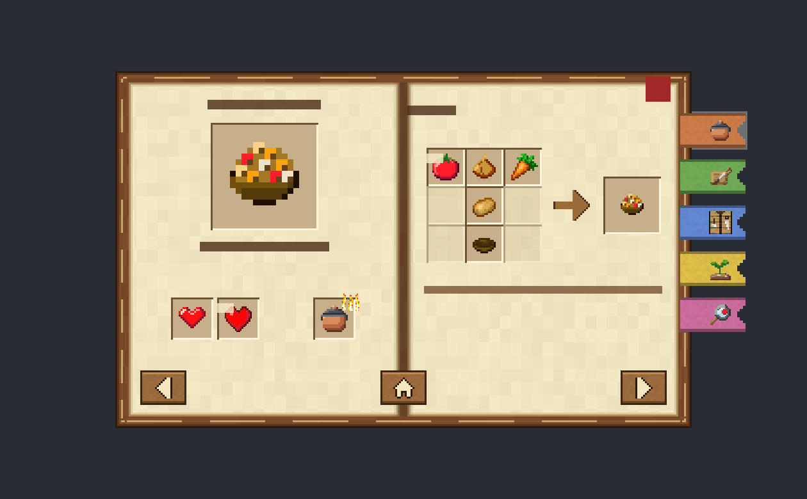
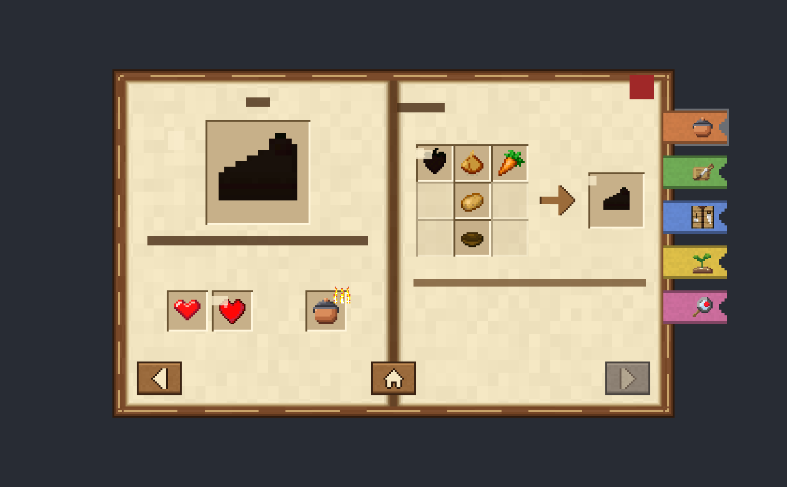
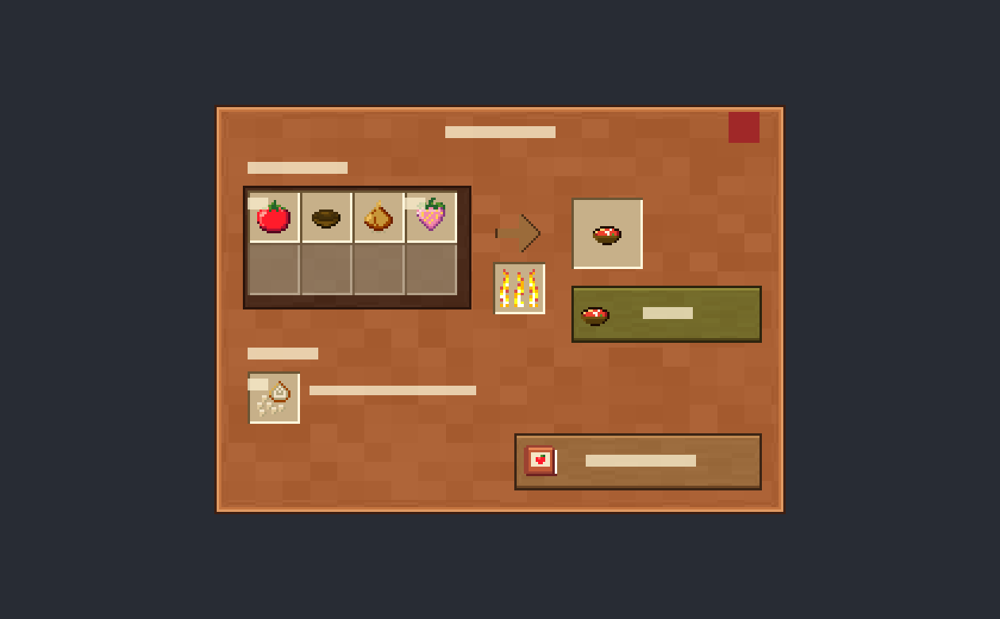
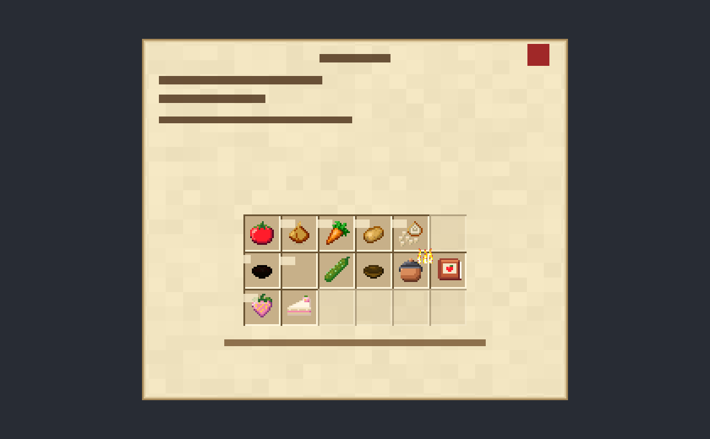

# S9: JSON UI form screen for the book and the pot (D13)

> **Closed 2026-10-22, not run in game.** D13 was reversed because of Microsoft's cooperative
> add-on rule against `ui/` overrides (§4.1); D14 (page images in a `CustomForm`) replaced it. The
> spike pack `packs/hk_ui_spike` is deleted (it is in git history at commit `86a3a4e`). This document
> stays as the record of what was learned.

**Question:** can a resource pack override draw a book-style layout only for forms whose title
carries our marker, leave every other form exactly vanilla, and map `ActionFormData` buttons to
fixed slots?

**Status (2026-10-22):** spike built and checked offline; **in-game test pending** (§5). Pack:
`packs/hk_ui_spike` (throwaway, never shipped). Game 1.26.52.3, `@minecraft/server` 2.10.0,
`@minecraft/server-ui` 2.2.0, no experiments.

> **Read §4.1 first.** Microsoft's own add-on guidelines say cooperative add-ons must not override
> files in `ui/`. The technique may work and still be off-limits for a Marketplace Add-On. That
> needs an answer from Waypoint before D13 goes beyond the portfolio build.

## 1. Files

| File                                                     | What it is                                                                                     |
| -------------------------------------------------------- | ---------------------------------------------------------------------------------------------- |
| `packs/hk_ui_spike/resource/ui/server_form.json`         | The only vanilla element we touch: `server_form.long_form`                                     |
| `packs/hk_ui_spike/resource/ui/_ui_defs.json`            | Registers our own file (additive; vanilla's list is not repeated)                              |
| `packs/hk_ui_spike/resource/ui/hk_ui_spike/forms.json`   | Namespace `hk_ui_spike`: the book, pot and data layouts and their slot/button templates        |
| `packs/hk_ui_spike/resource/textures/hk_ui_spike/*.png`  | Placeholder art: cover, page, gutter, slot, arrow, buttons, nav glyphs, ribbon, pot panel/well |
| `packs/hk_ui_spike/resource/textures/hk_ui_spike/icons/` | Copies of 18 Harvest Kitchen placeholder icons from `art/harvest_kitchen/generated/`           |
| `packs/hk_ui_spike/resource/texts/en_US.lang`            | Pack name plus the strings the layout itself shows ("Recipe", "In the pot", "Almost!")         |
| `packs/hk_ui_spike/scripts/main.ts`                      | `/scriptevent hk:uispike <case>` dispatcher                                                    |
| `packs/hk_ui_spike/scripts/config.ts`                    | Markers, the fixed index maps `BOOK` and `POT`, texture paths                                  |
| `packs/hk_ui_spike/scripts/slot-label.ts`                | The label code (§2.3), pure, unit-tested in `tests/slot-label.test.ts`                         |
| `packs/hk_ui_spike/scripts/slot-form.ts`                 | `SlotForm`: an `ActionFormData` with one button per fixed slot, empty slots filled in          |
| `packs/hk_ui_spike/scripts/show.ts`                      | Show with UserBusy retry, tap loop that reopens the form, chat reports                         |
| `packs/hk_ui_spike/scripts/cases/*.ts`                   | `book`, `pot`, `data`, `nav`, `shift`, `vanilla`, `modal`, `message`, `msgprefix`              |
| `s9-preview-*.png` (this folder)                         | Offline render of the layouts (§3). Text and counts are drawn as **bars**, not letters         |

`forms.json` was generated by a throwaway script (scratchpad, not in the repo) so the repeated
binding blocks stay identical. It's plain JSON; edit it directly from now on.

## 2. How it works

### 2.1 What vanilla 1.26.52 does (read from the game, not from tutorials)

From `resource_packs/vanilla/__brarchive/ui.brarchive` → `server_form.json`:

- `third_party_server_screen` → `main_screen_content` holds a factory `server_form_factory` with two
  control ids: `long_form` (ActionForm, and probably MessageForm; see `msgprefix`) and
  `custom_form` (ModalForm).
- `long_form@common_dialogs.main_panel_no_buttons` sets 8 properties (`$title_panel`,
  `$title_size`, `$title_max_size`, `size [225,200]`, `$text_name "#title_text"`,
  `$title_text_binding_type "none"`, `$child_control "server_form.long_form_panel"`, `layer 2`).
- Buttons live in `long_form_dynamic_buttons_panel`: a stack panel with
  `collection_name: "form_buttons"` and a factory whose `control_ids` are `button`, `label`,
  `header`, `divider`. **Labels, headers and dividers are items of the same collection as buttons.**
- `dynamic_button` binds `#form_button_texture` (→ `#texture`), `#form_button_texture_file_system`,
  `#form_button_text`, all `binding_type: collection` on `form_buttons`, and presses
  `button.form_button_click` with a `collection_details` binding. The body is a label on
  `#form_text`; the title binds `#title_text`.
- Fixed-index buttons have a vanilla precedent: `choose_realm_screen.json` `slots_grid` (parent
  `collection_name`, each button `collection_index: 0/1/2` + `collection_details`).
- `server_form.json` has no `_pocket` variant (checked against `_ui_defs.json`, 204 files).
  `npc_interact_screen.json` and `command_block_screen.json` don't reference `server_form`. The only
  other file that does is `pack_settings_screen.json`, which reuses `server_form.generated_contents`
  (ModalForm's part, which we don't touch).
- `libminecraftpe.so` strings contain `long_form`, `custom_form`, `server_form_factory`,
  `#title_text`, `#form_text`, `#collection_index` and `collection_details`. The `#form_button_*`
  names are **not** stored as plain strings (probably composed or hashed at runtime), so the
  vanilla JSON is the only source for them.
- Ore UI (`gui/dist/hbui/routes.json`) already has `/gameplay/data-driven` (that's `CustomForm` /
  DDUI), `/gameplay/inventory`, `/gameplay/trade` and `/gameplay/block-actors/:id`. The
  `ActionFormData` screen is still JSON UI in 1.26.52.

### 2.2 The override

`ui/server_form.json` redefines `server_form.long_form` as a plain panel with two children:

1. `long_form@common_dialogs.main_panel_no_buttons` with the **same 8 properties as vanilla
   1.26.52** (diffed by a script), plus a visibility binding:
   `((#title_text - '§h§k') = #title_text)`, i.e. "the title does not contain `§h§k`".
2. `hk_ui_spike.forms`, which holds three layouts. Each layout is visible only when the title
   contains its own marker: `(not ((#title_text - $hk_marker) = #title_text))`.

| Marker     | Layout                                                    |
| ---------- | --------------------------------------------------------- |
| `§h§k§1§r` | book spread (`book_layout`, 21 pinned buttons)            |
| `§h§k§2§r` | pot screen (`pot_layout`, 13 pinned buttons)              |
| `§h§k§3§r` | data probe (`data_layout`, a 6×3 `grid` over the buttons) |

The vanilla internals (`long_form_panel`, scrolling, buttons) are referenced, not copied, so they
still update with the game. Only the 8 properties of `long_form` itself are copies.

This is the same pattern as the most-used community project for it, Chest UI
([Herobrine643928/Chest-UI](https://github.com/Herobrine643928/Chest-UI), `RP/ui/server_form.json`,
last updated for game 26.40 on 2026-08-14). Its `server_form.json` has been stable since
2025-02, which is the main reason to expect this to work on 1.26.52.

Why `§h§k§n§r`: `§h` (quartz colour) + `§k` (obfuscated) is unlikely in anyone else's title, and
the trailing `§r` means that a form shown **without** our layout (another pack wins, §4.2) still
has a readable title, because all four codes come before the first visible character. A title
that contains only `§h` stays vanilla (the `vanilla` case checks this).

Title text: `(#title_text - $hk_marker)`; the leftover `§r` draws nothing.

### 2.3 Data passing: the label code

Every button label is `<role><count><display text>`, a **3-byte ASCII header** then any
RawMessage:

| Byte | Meaning                                                                                                                                                |
| ---- | ------------------------------------------------------------------------------------------------------------------------------------------------------ |
| 1    | role: `s` slot · `l` locked (the icon tinted near-black = silhouette, plus "?") · `h` needs heat (small flame) · `a` active chapter ribbon · `e` empty |
| 2-3  | count, drawn verbatim bottom-right: `"  "` none, `" 2"`, `"64"`, `"+1"`, `"8s"`                                                                        |
| 4+   | display text: tooltip on PC, the label on text buttons. Translated text, colour codes and any language are fine here                                   |

The JSON reads it with the format and subtraction tricks:

- role: `('%.1s' * #form_button_text) = 's'`
- count: `('§r' + (('%.3s' * #form_button_text) - ('%.1s' * #form_button_text)))`
- text: `(#form_button_text - ('%.3s' * #form_button_text))`
- empty: `(#form_button_text = '') or (role = 'e')`

`'%.Ns'` keeps the first N **bytes** (wiki.bedrock.dev; `§` is 2 bytes), so the header must stay
ASCII. `countField()` enforces that and a unit test checks every count shape is exactly 3 ASCII
bytes. RawMessage labels (`{rawtext: [{text: "s 2"}, {translate: "item.bowl.name"}]}`) are resolved
by the client before the bindings see them. Chest UI relies on the same thing (it cuts `'%.14s'`
off rawtext labels).

**Fixed indexes.** Each slot is a panel with `collection_index: N` under a container with
`collection_name: "form_buttons"`; inside it, a `common.button` with
`$pressed_button_name: "button.form_button_click"` and a `collection_details` binding, exactly
like `server_form.dynamic_button`. Book map (`config.ts` `BOOK`):

| Index | Book slot                                              | Index | Pot slot (`POT`)         |
| ----- | ------------------------------------------------------ | ----- | ------------------------ |
| 0-8   | 3×3 ingredient grid, row by row                        | 0-7   | "In the pot", 2 rows × 4 |
| 9     | result (also drawn 3× on left page)                    | 8     | heat (flame lit / unlit) |
| 10    | ◀ previous page                                        | 9     | result                   |
| 11    | ▶ next page                                            | 10    | Cook button              |
| 12    | Back / Home                                            | 11    | "Almost!" slot (`+1`)    |
| 13    | station (role `h` = flame badge)                       | 12    | Recipe Book button       |
| 14    | effect family badge                                    |       |                          |
| 15    | vanilla effect icon + duration `8s`                    |       |                          |
| 16-20 | ribbons: Pot, Board, Crafting, Crops, What can I make? |       |                          |

**Dead slots.** Every ActionForm row is a button, so an empty slot is still sent, as `"e  "` with
no icon. The layout draws it as an empty slot frame and **hides the button**, so it can't be
focused or clicked. The script never has to handle it. `SlotForm` sends exactly `size` buttons, so
index N of the form is always slot N of the layout. Disabled nav (◀ on page 1) is the same thing.

**Never use `label()`, `header()` or `divider()` in a marked form.** They take a place in
`form_buttons` and shift every slot after them. `SlotForm` has no way to add them, and the `shift`
case shows what happens when you do.

**Icons** come straight from `#form_button_texture`, so anything `ActionFormData.button(text,
icon)` accepts works: our RP textures and vanilla `textures/items/...`, `textures/ui/...`. That's
the advantage over `CustomForm.image()` (S1).

Example: what a real "Tomato Soup" book page would send (title and body are RawMessages):

```
title  "§h§k§1§r" + {translate: "item.hk:tomato_soup.name"}
body   {translate: "hk.book.blurb.tomato_soup"}
#0     "s 2" + Tomato              textures/hk/items/tomato
#1     "s  " + Bowl                textures/items/bowl
#2-#8  "e  "                       (empty)
#9     "s  " + Tomato Soup         textures/hk/items/tomato_soup
#10    "e  "                       (first page: ◀ greyed)
#11    "s  " + Next page
#12    "s  " + Back
#13    "h  " + Cooking Pot         textures/hk/items/cooking_pot
#14    "s  " + Heal                textures/hk/ui/family_heal
#15    "s8s" + Regeneration        textures/ui/regeneration_effect
#16    "a  " + Pot                 (open chapter)
#17-20 "s  " + Board / Crafting / Crops / What can I make?
```

A locked dish swaps role `s` for `l` on #9 and on its undiscovered crops; the icon stays the real
one and the layout makes the silhouette.

**Page turns** = the script sends a new form (the tap closes the old one). `tapLoop` in `show.ts`
reopens after every tap; check in game how the close/open animation feels (§5 step 15).

### 2.4 What the layouts contain

- **Book** (300×186 + ribbons sticking out 28 px on the right): leather cover (nineslice), two
  parchment pages, a centre gutter. Left page: title, the dish at 48×48 in a frame, body text
  (2 lines max), family + effect + station slots, ◀. Right page: "Recipe", 3×3 grid of 20 px slots,
  arrow, 30 px result slot, the hint "Tap a slot to see where it comes from", ▶. Home is centred
  on the gutter. Close X top right. Ribbons are tinted copies of one white texture.
- **Pot** (240×172): copper panel; "In the pot" well with 2×4 slots of 22 px; arrow with the heat
  slot under it; result; a green-tinted Cook button; "Almost!" row with a `+1` slot; Recipe Book
  button; close X.
- **Data** (252×214): probes for `'%.Ns'` and string subtraction, the body, and a 6×3 `grid`
  bound to `form_buttons`, which is the "N buttons, grid assigns the index" alternative to pinning.

## 3. Verified offline vs in game

| Requirement                                                      | Status                         | Evidence                                                                                                                                                                     |
| ---------------------------------------------------------------- | ------------------------------ | ---------------------------------------------------------------------------------------------------------------------------------------------------------------------------- |
| Element and binding names we depend on exist in 1.26.52          | **verified offline**           | extracted `server_form.json`, `ui_common.json`, `ui_template_dialogs.json`; script check: all 33 `@` references resolve, all 18 fixed textures exist                         |
| Copied `long_form` properties equal vanilla 1.26.52              | **verified offline**           | script diff, 8/8 equal                                                                                                                                                       |
| Pinned indexes cover 0..20 (book) and 0..12 (pot) exactly once   | **verified offline**           | script check against `forms.json`; `config.ts` uses the same maps                                                                                                            |
| Header always 3 ASCII bytes                                      | **verified offline**           | `npm test` (`slot-label.test.ts`)                                                                                                                                            |
| Layout geometry (nothing overlaps or falls off)                  | **verified offline (approx.)** | `s9-preview-*.png`: a small interpreter of our JSON (anchors, offsets, nineslice, grid, view expressions under the assumed semantics). Not the game's renderer               |
| Expressions mean what §2.3 says                                  | plausible                      | they evaluate correctly in the preview interpreter **assuming** `-` removes a substring and `'%.Ns'` keeps N bytes (wiki); the `data` case probes both in game               |
| Prefixed form shows our layout, unprefixed stays vanilla         | plausible                      | same pattern as Chest UI (works through game 26.40); untested on 1.26.52                                                                                                     |
| JSON UI merges our `long_form` with vanilla as Chest UI expects  | plausible                      | the `modifications` mechanism only makes sense if pack files merge per element; the wiki says pack UI files "automatically get merged"; the exact merge rule is undocumented |
| `collection_index` on nested panels, `collection_details` clicks | plausible                      | vanilla `choose_realm_screen.json` precedent (direct child); ours are 1-2 levels deeper, so every container in between also sets `collection_name`                           |
| Dead slot can't be focused or clicked                            | plausible                      | the button is hidden (`#visible` false); hidden controls aren't focusable in vanilla screens                                                                                 |
| Silhouette by tinting the icon (`color` on an image)             | plausible                      | `color` on images is used across vanilla (`$button_image_color`)                                                                                                             |
| RawMessage text resolved before the string ops                   | plausible                      | Chest UI depends on it; `data` #3 and #10 test it                                                                                                                            |
| MessageForm goes through `long_form`                             | unknown                        | the factory has only `long_form` and `custom_form`; `msgprefix` answers it                                                                                                   |
| Controller focus, touch, narrator, GUI scales, Pocket profile    | unknown                        | in-game only (§5)                                                                                                                                                            |
| Marketplace allows it                                            | **unknown, likely not**        | §4.1                                                                                                                                                                         |

Previews (layout only; letters and numbers are bars; the data is approximate):

 
 

## 4. Risks

### 4.1 Marketplace policy (top risk; question for Waypoint)

Microsoft Learn, **"Guidelines for Building Cooperative Add-Ons"** (updated 2025-07-22), under
"Types of Customizations to Avoid":

> Do not override UI files (resource packs/ui)

and, as its own section:

> **JSON UI and Custom Fonts overrides are disalllowed.** Because JSON UI (i.e., files in
> <resource pack name>/ui) and fonts (i.e., files in <resource pack name>/font) are not
> overridable in a cooperative manner - such that multiple Add-Ons can customize the same asset -
> cooperative Add-Ons should not override any JSON UI or font glyph files.

The summary repeats it ("Do not use certain features, like custom dimension sizes or UI JSON
overrides"). The same page says Mojang's validator ([mctools.dev](https://mctools.dev), "Add-On
Best Practices") checks add-ons against these rules. Marketplace **Add-Ons** (the product type
that sits on top of any world) are, as far as I can tell, held to these cooperative rules.
Marketplace **worlds** have shipped custom JSON UI for years. I could not find a current
Marketplace content-policy page that settles it either way.

Questions for Waypoint:

1. Will a Marketplace Add-On be rejected for any file under `RP/ui/`, even one that only changes
   forms whose title carries our marker and leaves every other form vanilla?
2. If yes: is a separate "Harvest Kitchen world" (a world template with the add-on built in)
   allowed to use it, while the Add-On version stays on plain `ActionFormData`?
3. Do they run the mctools.dev "Add-On Best Practices" validation, and does a `ui/` folder fail it?
4. Does the guideline's `"pack_scope": "world"` (RP manifest) apply to us? (Not used by any pack
   in this repo yet; separate from S9 but on the same page.)

Until there's a yes, treat D13 as **portfolio-only**: fine for showing polish in the application
build, not safe for the Marketplace Add-On.

### 4.2 Conflicts with other add-ons and Marketplace content

- **How packs combine:** each pack's `ui/_ui_defs.json` only lists its **new** files, and those
  lists are additive, so our `ui/hk_ui_spike/forms.json` (own namespace) can't collide unless
  another pack uses the namespace `hk_ui_spike`. `ui/server_form.json` is different: it's a
  vanilla path, and every pack that has one patches the same elements. For a given element, the
  pack higher in the stack wins for each property it sets, and a `controls` or `bindings` array it
  sets **replaces** the lower pack's array; only the `modifications` operations edit arrays
  in place. The exact merge rule isn't documented; this is inferred from how `modifications`
  works and from Chest UI.
- **Two packs that both redefine `long_form`** (Chest UI and nearly every "custom server form"
  pack do): the higher pack's `controls` win. Our layout disappears, and because the winner's
  vanilla child only hides on **its** marker, our marked forms render as **plain vanilla dialogs
  with the codes visible** ("s 2Tomato", 21 rows). The game shows no error. The opposite happens
  if we win.
- **The winner also decides how everyone's vanilla forms look.** Chest UI's copy of the vanilla
  properties is already stale against 1.26.52 (`$title_size` "100% - 14px" vs vanilla's "15px",
  no `$title_max_size`). If such a pack sits above ours, every ActionForm in the world uses its
  stale copy. That isn't our bug, but players see it while our add-on is active.
- **Marketplace worlds with their own UI** (many maps reskin forms) behave the same; world packs
  normally sit above add-ons.
- **The script can't detect** which layout is drawn, or whether our RP is even active.
- Mitigations to try in an S9b (untested here):
  - add our panel with `"modifications": [{"array_name": "controls", "operation": "insert_back",
...}]` on `long_form` instead of redefining it, so two cooperative packs could both insert.
    Hiding the vanilla content would still need a binding on a vanilla element, and that is the
    part that can't be cooperative;
  - an **invisible header** (only `§` codes, e.g. `§<role>§<d1>§<d2>§r`, cut with `'%.12s'`), so a
    losing layout degrades to a readable vanilla list instead of showing codes. Needs a check of
    which codes render as nothing (a digit after `§` is a colour code, so the trailing `§r`
    matters).

### 4.3 Game updates

What breaks if Mojang renames or restructures it (re-check on every game update):

- `server_form.long_form` as the factory's control id for ActionForm, and the 8 copied properties
  (our copy goes stale like Chest UI's did; the vanilla regression steps in §5 catch it);
- `server_form.long_form_panel`, `common_dialogs.main_panel_no_buttons`, `common.button`,
  `common.close_button`, `common.hover_text`;
- the bindings `#title_text`, `#form_text`, `#form_button_text`, `#form_button_texture`,
  `#form_button_texture_file_system`, the collection `form_buttons`, `button.form_button_click`,
  `collection_details`;
- the rule that label/header/divider share `form_buttons` (true since those elements were added to
  `ActionFormData`);
- the `'%.Ns'` and `-` string semantics.

The bigger one: **the form screen moving to Ore UI.** In 1.26.52, CustomForm (DDUI), the
inventory, trading and container screens are already Ore UI routes; wiki.bedrock.dev states
"JSON UI is being deprecated in favor of Ore UI". When ActionForm moves, our `ui/` files are
ignored without an error, and marked forms fall back to vanilla with visible codes (see the
invisible-header mitigation above). Chest UI shipped "update" commits for 1.21.70, .90, .131,
26.20, 26.30 and 26.40. The one I inspected (26.40) only changed its numeric item-ID table and
`forms.js`, which we avoid by using texture paths; its `server_form.json` last changed in 2025-02.

### 4.4 PC, touch and controller

- Our buttons are `common.button` (vanilla template): `focus_enabled`, spatial focus
  (`focus_magnet_enabled`), focus wrap, `button.menu_select`/`menu_ok` mappings. Expected to work
  with mouse, touch and gamepad, but focus order, the first focused slot and whether focus is
  visible (we draw the highlight in the **hover** state and rely on focus using it) are unknown.
- Touch has **no hover**, so slot names (tooltips) never show. A child can still tap an
  ingredient and get the "where do I get this?" answer, but can't read names in the grid. A real
  book would need the name somewhere on the page (a "selected" caption isn't possible: forms
  can't update while open).
- Tap targets: 20-22 UI units for slots (vanilla inventory slots are 18, vanilla form buttons are
  32 tall). Nav buttons 24×18. Probably fine on a phone, too small for small children on a small
  phone; check.
- No scrolling: the layouts are fixed size, so nothing scrolls, but nothing reflows either.
- Escape / B close the form through the screen's own `menu_cancel → menu_exit` mapping (vanilla,
  untouched), and the X is `common.close_button`.

### 4.5 Pocket vs Classic, screen size, GUI scale

- `server_form.json` has no `_pocket` file; `ui_common_classic.json` overrides only 10 `common`
  elements. Our layout uses fixed UI units, so both profiles should look the same; vanilla forms
  keep their profile differences.
- Sizes in UI units: book 300×186 (328 wide with ribbons), pot 240×172, data 252×214. Vanilla's
  form is 225×200, which Mojang evidently treats as safe on every screen. The data layout (214
  tall) is the most likely to clip on a wide phone at a large GUI scale; it's test-only. A real
  book should stay ≤ 200 tall.
- No layout adapts to the screen (no `variables` on `$pocket_screen` etc. yet). That's possible
  later with the same mechanism vanilla uses, at the cost of more vanilla-name coupling.

### 4.6 Accessibility and narration

- The narrator (UI screen reader) probably reads our slot buttons as just "Button": they have no
  text child, and `common.button`'s default `tts_name` is `accessibility.button.tts.title`. Vanilla
  form buttons read their label. A fix would bind `tts_name`/`$button_tts_name` to the name (to
  try in S9b). The screen title isn't announced either (vanilla's title label sets the
  `#tts_dialog_title` property bag; ours doesn't).
- Locked dishes use shape ("?" + silhouette), not colour only. Text is dark brown on parchment
  and light text with a shadow on copper. Small text (0.8 scale) is used only for hints.
- Labels use the default font, so the player's font setting applies.

### 4.7 Localization

- All dish, crop and button text still comes from the script as RawMessage (`translate` keys),
  resolved by the client before the layout cuts the header. The header is ASCII, so this works in
  any language, including Ukrainian.
- Strings owned by the layout ("Recipe", "In the pot", "Almost!") are RP lang keys in labels; the
  spike ships only `en_US`. Shipping needs every language's `.lang`, as for the rest of the pack.
- Fixed-size labels clip long translations (title ≈ 20 characters, body 2 lines). German and
  Ukrainian dish names need checking. No `%` in layout lang strings (a label may treat it as a
  format).

### 4.8 Data-passing fragility (summary)

| Trick                              | Fragile because                                               | Guard                                   |
| ---------------------------------- | ------------------------------------------------------------- | --------------------------------------- |
| Fixed index per slot               | label/header/divider shift it                                 | `SlotForm` can't add them; `shift` case |
| Every slot sent, empty = `"e  "`   | a missing button shifts nothing but leaves a stale slot       | `SlotForm` always sends `size` buttons  |
| `'%.Ns'` cuts bytes                | non-ASCII header breaks it                                    | `countField` throws; unit test          |
| `-` for "contains"                 | first vs all matches undocumented                             | markers are unique; `data` probe        |
| Title marker anywhere in the title | any title containing `§h§k` hides the vanilla form            | marker chosen to be unlikely            |
| Page turn = new form               | close/open animation each time; UserBusy if reopened too fast | `showWhenFree` retries; check the feel  |

## 5. In-game test

Report as a numbered list: `ok`, or what you saw (a screenshot helps). Every tap prints
`[S9 <case>] tapped #N = …` in chat. The marked forms **reopen after every tap**; close them with
the X or Esc to stop.

### Setup

1. Settings → Creator → **Enable Content Log File** on.
2. `npm run build && npm run deploy` (done by you; not run by the spike agent).
3. New world: Creative, **cheats on**, all experiments off. Behavior packs: **HK UI Spike BP** and
   **Harvest Kitchen**. Resource packs: check that **HK UI Spike RP** and Harvest Kitchen RP are
   both listed as active.
   → No pack error dialog.
4. Fly for 1-2 minutes (pushes load messages into the log file).
5. `/scriptevent hk:uispike help`
   → chat: `[S9 help] cases: book, pot, data, nav, shift, vanilla, modal, message, msgprefix (pot cold)`.

### A. Vanilla forms must be untouched (regression)

6. `/scriptevent hk:uispike vanilla`
   → the normal grey dialog, ~225×200: title "Vanilla ActionForm" with "Vanilla" in quartz colour;
   body, a header, a label, a divider, 4 icon buttons (carrot, tomato, none, bowl with a long
   wrapped label); scrolls like vanilla. Tap "No icon" → `selection #2`. **Screenshot it.**
7. `/scriptevent hk:uispike modal`
   → vanilla ModalForm with header, label, divider, toggle (on), slider (4), dropdown (Two), text
   field, Submit. Submit → `values [...]`.
8. `/scriptevent hk:uispike message`
   → vanilla MessageForm, two buttons. Tap Button 1 → `selection #0` (report the number you get).
9. Harvest Kitchen book: `/give @s hk:recipe_book`, use it; open a few pages; also use a pot with
   items in it to open the pot screen.
   → Exactly as in the last playtest (same dialog, buttons, icons).
10. Other vanilla screens: place a command block and open it; `/summon npc` and open its dialog.
    → Unchanged (they don't use `server_form.json`, verified offline).
11. Optional A/B: leave the world, deactivate HK UI Spike BP + RP, reopen it, repeat step 9's book
    page and compare screenshots, then reactivate.
    → Pixel-identical dialogs.

### B. Book

12. `/scriptevent hk:uispike book`
    → Compare with `s9-preview-book.png`: leather book, two parchment pages, centre gutter, X top
    right, five coloured ribbons on the right edge with icons (Pot has a light outline). Left:
    "Tomato Soup", big soup icon, "Warm and red. Heals a little.", heart, regeneration icon with
    `8s`, pot with a small flame. Right: "Recipe", 3×3 grid with tomato `2` and bowl, the rest
    empty, arrow, soup in the result slot, the hint line. Bottom: ◀ greyed, home, ▶.
    **No grey vanilla dialog anywhere, no `§` junk in the title.**
13. Tap, in order: tomato, bowl, result, station, heart, regeneration, each ribbon top to bottom,
    home.
    → `#0`, `#1`, `#9`, `#13`, `#14`, `#15`, `#16`…`#20`, `#12`; the form reopens each time.
14. Tap an empty grid slot and the greyed ◀.
    → Nothing: no chat line, no click sound, the form stays.
15. ▶ → `#11`, page 2 "Vegetable Stew" (tomato, onion, carrot, potato, bowl spread over the grid;
    ◀ now active). How does the page turn feel (close/open animation, flicker)?
16. ▶ again → page 3: title "???", a black cake silhouette with "?", black strawberries with "?"
    and `3`, milk/sugar/egg/wheat normal, crafting table as station without a flame, ▶ greyed.
    ◀ ◀ back to page 1.
17. **PC:** hover the slots. → A highlight, and a tooltip with the name only ("Tomato", "Bowl",
    "Regeneration"); no `s 2` prefix.
18. X → `closed (UserClosed)`. Open again, Esc → the same.

### C. Pot

19. `/scriptevent hk:uispike pot`
    → Compare with `s9-preview-pot.png`: copper panel, "Cooking Pot", "In the pot" well with
    tomato `2`, bowl, onion, strawberry `12`, four empty; arrow, lit flame under it; soup result;
    green Cook! button with a soup icon; "Almost!" with chopped onion `+1` and its hint; Recipe
    Book button bottom right.
20. Tap the flame → `#8`; it reopens with an unlit flame and Cook greyed (not clickable). Tap the
    flame again → lit, Cook active.
21. Tap tomato → `#0`, the slot is empty after reopening. Take out all four → result and Cook
    greyed.
22. Cook!, Almost, Recipe Book → `#10`, `#11`, `#12`.
23. `/scriptevent hk:uispike pot cold` → starts unlit.

### D. Data tricks

24. `/scriptevent hk:uispike data` (compare with `s9-preview-data.png`)
    → Report the two probe lines exactly:
    - `Prefix cut counts BYTES` or `…CHARACTERS` (expected BYTES; if neither shows, say so);
    - `minus: Data -AB` (`-` removes the first match) or `minus: Data -` (all matches).
25. Grid cells, left to right, top to bottom; expected:
    1 tomato, no number · 2 onion `2` · 3 carrot `64` · 4 potato `99` · 5 chopped onion `+1` ·
    6 empty (not clickable) · 7 black soup silhouette + `?` · 8 no icon, `3` · 9 cucumber (long
    tooltip) · 10 bowl (tooltip "Bowl", translated) · 11 pot with flame · 12 recipe book ·
    13 strawberry `5` (tooltip red/green) · 14 cake (icon path with `.png`: blank or not?) ·
    15-18 empty, not clickable.
26. Tap each live cell → chat `#` = cell number − 1. Hover cell 9 (PC): how does the long tooltip
    wrap?

### E. Index mapping

27. `/scriptevent hk:uispike nav`
    → Book layout; every grid slot shows its own index as the number. Tap **every** slot, ribbon
    and nav button → each chat `#N` matches the number shown (or, for nav/ribbons, the tooltip
    `#N name` on PC). Report any mismatch.
28. `/scriptevent hk:uispike shift` (a label before #0, a divider after #4; opens once)
    → Expected broken on purpose: slots shifted by one and then two. Tap the slot that shows `0`,
    then reopen and tap the one that shows `9`. Report what chat says (`selection #?`). This
    decides whether labels can ever be mixed in.
29. `/scriptevent hk:uispike msgprefix`
    → Either the book layout with two slots (then MessageForm uses `long_form`), or a vanilla
    message dialog. Report which, and the tap result.

### F. Input, profiles, scales

30. **Controller** (if one works with mcpelauncher): open `book`. D-pad/stick moves focus between
    slots, ribbons, nav, X; A presses; B closes. Report: where focus starts, whether every live
    slot is reachable, whether focus is visible, whether empty slots are skipped.
31. **Keyboard only:** arrows/Tab + Enter in `book`. Same questions.
32. **Touch** (Android phone, if you have one with the packs): `book` and `pot`. Taps register on
    the right slot; slot size is comfortable; no tooltips (expected).
33. **UI Profile:** switch Classic ↔ Pocket in Settings, reopen `book`, `pot` and `vanilla`.
    → Our layouts look the same in both; `vanilla` looks like vanilla in each profile.
34. **GUI scale:** Settings → Video → GUI scale modifier at its smallest and largest; also a small
    window (~854×480). Open `book`, `pot`, `data`.
    → Report anything clipped or off-screen (the book with ribbons is 328 units wide, data 214
    tall).
35. **Narrator:** turn on the UI screen reader (Settings → Accessibility), open `book`, move
    focus over a few slots. Report what it reads.
36. **Language:** switch to Українська, open `book` and `data`.
    → Bowl/Carrot/Potato/Regeneration names in Ukrainian with the counts intact; the layout's own
    strings ("Recipe", "Almost!") show English or a raw key (only `en_US` is shipped). Report
    which.

### G. Coexistence and log

37. `/hk:debug validate` → `Data check: 0 problem(s)`; HK book and pot work (steps 9).
38. Quit; open the newest `ContentLog*.txt`:
    `grep -v '\[verbose\]' <file> | grep -v '^$' | grep -i -E 'ui|hk_ui_spike|server_form|json'`
    → Nothing from `hk_ui_spike` or `server_form`. Paste anything that shows up.

## 6. Go / no-go

**Go (technical)** only if all of these hold:

1. Steps 6-11: every unmarked form and the current HK book look exactly vanilla, on PC.
2. Steps 12-23: book and pot render as designed, never together with the vanilla dialog.
3. Step 27: all 21 indexes map correctly. Steps 14, 20: empty slots can't be clicked.
4. Step 30 or 32: works with at least one non-mouse input (controller or touch), every live slot
   reachable.
5. Step 34: book and pot fit at the smallest and largest GUI scale on an 854×480 window (or we
   know the limit and can size the real book under it).
6. Step 38: no Content Log errors from the pack.

**Go (shipping in the Marketplace Add-On)** additionally needs Waypoint's yes to §4.1. Without
it, D13 is portfolio-only.

**No-go** if any of: a vanilla form changes; the marked layout doesn't show, or shows together
with the vanilla dialog; indexes can't be made reliable; focus can't reach the slots; Waypoint
says no for Add-Ons and we don't want a separate world product.

**Nice-to-know, not blocking:** narrator text (fixable later), tooltips on touch (design around
it), the shift result, msgprefix.

## 7. If no-go: fallback

Stay on `ActionFormData` as D11 says, and spend the time on clarity instead of chrome:

- **Icons on every row**, generated art for missing ones (the 4.3 UI asset list), vanilla effect
  icons on the effect row.
- **Shorter labels:** `×2 Tomato` → `2 Tomato`; one idea per row; few words (plan §2.2).
- **Group with the elements we have:** `header()` for "Recipe" / "Where to find", `label()` for
  the effect line, `divider()` before Back. These cost nothing in vanilla forms.
- **The body as the "left page":** dish name in the title, effect glyphs (S2: ❤ ★ ♨) and the
  station in the body.
- Keep the "every row does something" rule and the ingredient → source chain (plan §3).
- Watch `CustomForm` (DDUI, Ore UI route `/gameplay/data-driven`): it's Mojang's sanctioned way to
  richer script UI. If it gains icon buttons or rows (S1's blockers), revisit the book there.

## 8. Sources

- Game files, 1.26.52.3: `resource_packs/vanilla/__brarchive/ui.brarchive` (`server_form.json`,
  `ui_common.json`, `ui_template_dialogs.json`, `ui_template_buttons.json`,
  `choose_realm_screen.json`, `_ui_defs.json`), `…/textures/ui.brarchive`,
  `lib/x86_64/libminecraftpe.so` (strings), `gui/dist/hbui/routes.json`.
- Microsoft Learn, [Guidelines for Building Cooperative Add-Ons](https://learn.microsoft.com/en-us/minecraft/creator/documents/practices/guidelinesforbuildingcooperativeaddons?view=minecraft-bedrock-stable),
  updated 2025-07-22 (no game version given).
- wiki.bedrock.dev, [JSON UI intro](https://wiki.bedrock.dev/json-ui/json-ui-intro): `modifications`
  operations, `_ui_defs.json`, `'%.Ns'` counts bytes, the Ore UI deprecation note (no game
  version given).
- [Herobrine643928/Chest-UI](https://github.com/Herobrine643928/Chest-UI) at commit `115d95c8`
  ("26.40 Update", 2026-08-14): `RP/ui/server_form.json`, `RP/ui/chest_server_form.json`,
  `BP/scripts/extensions/forms.js`.
